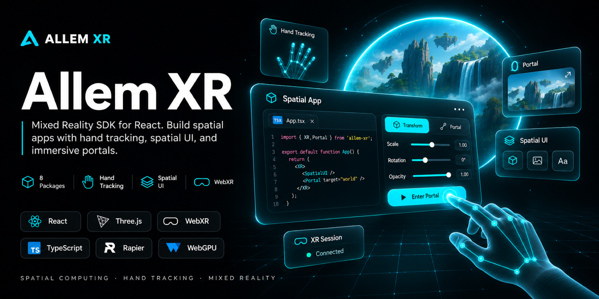

<p align="center">
  
</p>

<p align="center">
  <a href="https://doi.org/10.5281/zenodo.24243177"></a>
  <a href="https://www.npmjs.com/package/@allem-xr/core"></a>
  <a href="./LICENSE"></a>
  
  
  
</p>

<p align="center">
  <strong>The React SDK for Mixed Reality</strong><br/>
  Build XR apps as easily as you build web apps.
</p>

---

## What is Allem XR?

Allem XR is a modular React SDK for building mixed reality experiences on the web. It wraps the WebXR Device API into ergonomic React hooks and components built on [React Three Fiber](https://github.com/pmndrs/react-three-fiber), so you can build immersive VR and AR apps with the tools you already know.

**8 focused packages.** Import only what you need. Hand tracking without physics. Spatial UI without avatars. Your bundle stays small.

```bash
npx create-allem-xr my-app
```

## The Simplest XR App

```tsx
import { XRProvider, XRScene, XROrigin } from '@allem-xr/core'
import { HandModel } from '@allem-xr/hands'
import { Canvas } from '@react-three/fiber'

function App() {
  return (
    <XRProvider features={['hand-tracking']}>
      <Canvas>
        <XRScene>
          <XROrigin />
          <HandModel hand="left" color="#00ffaa" />
          <HandModel hand="right" color="#00aaff" />
          <mesh position={[0, 1.5, -1]}>
            <boxGeometry args={[0.2, 0.2, 0.2]} />
            <meshStandardMaterial color="hotpink" />
          </mesh>
          <ambientLight />
        </XRScene>
      </Canvas>
    </XRProvider>
  )
}
```

That's it. Session management, hand tracking, and 3D rendering — no boilerplate.

## Features

### Hand Tracking & Gestures
25-joint hand tracking with built-in gesture detection. Pinch, grab, point, fist, open-palm — or define your own.

```tsx
import { useGesture } from '@allem-xr/hands'

const pinch = useGesture('pinch', { hand: 'right' })
// → { active: true, confidence: 0.95, position: Vector3 }
```

Also: `useCustomGesture` for custom detectors, `usePinchInteraction` and `useGrabInteraction` for mesh interaction, `HandRay` for pointing.

### Spatial Understanding
Hit testing, plane detection, persistent spatial anchors, scene mesh, depth sensing, and light estimation.

```tsx
import { usePlanes, useHitTest } from '@allem-xr/spatial'

const { planes } = usePlanes({ filter: 'horizontal' })
const { results } = useHitTest({ source: 'viewer' })
```

Also: `useAnchor` for persistent spatial anchors, `useSceneMesh` and `SceneMeshOccluder` for scene mesh, `useDepth` for depth sensing, `useLightEstimate` for lighting, `PlaneOverlay` and `SurfacePlacer` components.

### Spatial UI
Panels, buttons, sliders, toggles, and more — rendered as Three.js geometry. Works in VR, AR, and on desktop.

```tsx
import { Panel, Button, Text, Slider } from '@allem-xr/ui'

<Panel position={[0, 1.5, -1]} followGaze>
  <Text fontSize={0.03}>Settings</Text>
  <Slider value={volume} onChange={setVolume} label="Volume" />
  <Button onSelect={save}>Save</Button>
</Panel>
```

Also: `Toggle`, `ProgressBar`, `Tooltip`, `RadialMenu`, `SpatialText`, `GazePointer`, and `useGazeInteraction` for gaze-based UI.

### Physics with Real-World Colliders
Rapier WASM physics that interacts with detected real-world surfaces. Throw virtual objects and watch them bounce off your real table.

```tsx
import { PhysicsWorld, RigidBody, RealWorldCollider } from '@allem-xr/physics'

<PhysicsWorld>
  <RealWorldCollider source="planes" planes={detectedPlanes} />
  <RigidBody type="dynamic" collider="ball" args={[0.05]}>
    <mesh><sphereGeometry /><meshStandardMaterial /></mesh>
  </RigidBody>
</PhysicsWorld>
```

Also: `useHandPhysics` for hand-driven rigid bodies, `useGravity` for gravity control, `useCollision` for collision callbacks.

### Spatial Audio
HRTF-based positional audio with automatic listener sync to the XR head pose.

```tsx
import { SpatialAudioSource, useAudioListener } from '@allem-xr/audio'

useAudioListener() // syncs to camera
<SpatialAudioSource src="/waterfall.mp3" position={[5, 0, -3]} autoplay loop />
```

Also: `useAmbientAudio` for non-spatial background music, `AudioZone` for region-based audio effects.

### Avatars & IK
Load GLB/VRM models, drive them with XR tracking, and see yourself in a mirror.

```tsx
import { Avatar } from '@allem-xr/avatars'

<Avatar model="/character.vrm" trackHead trackHands estimateBody />
```

Also: `useAvatarTracking` for manual IK target control, `useIK` for the FABRIK solver, `AvatarMirror` for VR mirrors.

### Portals & Transitions
Walk through a portal into a virtual world. Stencil-buffer rendering creates the "window into another reality" effect.

```tsx
import { Portal, Guardian } from '@allem-xr/portals'

<Portal position={[0, 0, -2]} size={[1.5, 2]}>
  <VirtualRoom />
</Portal>
<Guardian radius={2} fadeDistance={0.5} />
```

Also: `useSceneTransition` for animated scene changes, `usePassthrough` for passthrough state, `PassthroughWindow` for passthrough holes in VR, `useGuardian` for boundary tracking.

## Packages

| Package | What it does |
|---------|-------------|
| [`@allem-xr/core`](./packages/core) | Session management, input abstraction, capability detection |
| [`@allem-xr/hands`](./packages/hands) | 25-joint hand tracking, gestures, pinch/grab interaction |
| [`@allem-xr/spatial`](./packages/spatial) | Hit testing, planes, anchors, scene mesh, depth, lighting |
| [`@allem-xr/ui`](./packages/ui) | Panels, buttons, sliders, toggles, text — all in 3D |
| [`@allem-xr/physics`](./packages/physics) | Rapier WASM physics, rigid bodies, real-world colliders |
| [`@allem-xr/audio`](./packages/audio) | HRTF spatial audio, ambient audio, listener sync |
| [`@allem-xr/avatars`](./packages/avatars) | GLB/VRM loading, IK solver, XR-driven avatar tracking |
| [`@allem-xr/portals`](./packages/portals) | Stencil portals, scene transitions, guardian boundaries |

## Why Allem XR?

| | Allem XR | @react-three/xr | A-Frame | Raw WebXR |
|---|---|---|---|---|
| **React-native** | hooks + JSX | hooks + JSX | HTML custom elements | imperative |
| **Modular** | 8 packages, import what you need | monolith | monolith | N/A |
| **Hand tracking** | 25-joint + 5 gestures + custom | basic input sources | community component | manual |
| **Spatial UI** | Panel, Button, Slider, Toggle... | none built-in | basic panels | manual |
| **Physics** | Rapier + real-world colliders | none (use rapier separately) | community component | manual |
| **Spatial audio** | HRTF + listener sync | none | basic | manual |
| **Avatars + IK** | GLB/VRM + FABRIK + body estimation | none | community component | manual |
| **Portals** | stencil-buffer rendering | none | none | manual |
| **Error messages** | contextual with device support | raw browser errors | generic | raw |
| **TypeScript** | strict, full inference | yes | no | N/A |
| **CLI scaffolding** | `npx create-allem-xr` | none | none | none |

## Quick Start

### Option 1: Scaffold a new project

```bash
npx create-allem-xr my-app
cd my-app
npm install
npm run dev
```

Opens a working XR app with hand tracking, HTTPS dev server, and hot reload.

> **Note:** WebXR requires HTTPS. The dev server uses [mkcert](https://github.com/nicolo-ribaudo/vite-plugin-mkcert) for local HTTPS certificates automatically.

### Option 2: Add to an existing R3F project

```bash
npm install @allem-xr/core @allem-xr/hands
```

```tsx
import { XRProvider, XRScene } from '@allem-xr/core'

// Wrap your existing Canvas:
<XRProvider>
  <Canvas>
    <XRScene>
      {/* your existing R3F scene */}
    </XRScene>
  </Canvas>
</XRProvider>
```

## Device Support

| Device | VR | AR | Hands | Planes | Anchors |
|--------|----|----|-------|--------|---------|
| Meta Quest 2/3/Pro | yes | yes | yes | yes | yes (persistent) |
| Apple Vision Pro | yes | — | gaze+pinch | — | — |
| Android (Chrome) | yes | yes | — | partial | partial |
| Desktop (emulator) | yes | yes | emulated | emulated | emulated |

## Architecture

```
Your App
  └─ @allem-xr packages (hooks + components)
       └─ React Three Fiber (reconciler)
            └─ Three.js (scene graph + rendering)
                 └─ WebXR Device API + WebGPU/WebGL2
```

- **Frame-loop native**: Per-frame data (poses, joints) lives in refs. React only re-renders for session-level changes.
- **Capability-detected**: Every hook returns `{ supported: false }` gracefully when features aren't available.
- **Peer dependencies**: R3F, Three.js, and React are peer deps. You control the versions.
- **SSR-safe**: All packages use `"use client"` directives.

## Demo Apps

The repo includes 9 demo apps in `apps/` — from tech demos to premium experiences:

### Flagship

| Demo | Packages | Description |
|------|----------|-------------|
| **[Mixed Reality Playground](./apps/mixed-reality-playground)** | all 8 | Portal to an ethereal world, glass physics objects, spatial UI control panel, hand tracking, guardian boundary — the full SDK in one scene |

### Premium Experiences

| Demo | Packages | Description |
|------|----------|-------------|
| **[Zen Garden](./apps/zen-garden)** | core, hands, ui, audio, portals | VR meditation — reflective water pool, river stones, cherry blossoms, fireflies, bamboo, breathing guide |
| **[Spatial Analytics](./apps/spatial-analytics)** | core, hands, ui | Enterprise dashboard — animated 3D bar charts, KPI ring charts, floating metric orbs, glass panels |

### Feature Demos

| Demo | Packages | Description |
|------|----------|-------------|
| **[Physics Playground](./apps/physics-playground)** | physics, spatial, hands | Spawn objects that bounce off real surfaces with hand physics |
| **[Spatial Notes](./apps/spatial-notes)** | spatial, hands | Pinch to place sticky notes on real-world surfaces |
| **[Portal Gallery](./apps/portal-gallery)** | portals, hands | Walk through portals into forest, ocean, and space worlds |
| **[Avatar Mirror](./apps/avatar-mirror)** | avatars, hands, audio | VR room with real-time mirror reflection |
| **[Spatial Dashboard](./apps/spatial-dashboard)** | ui, hands | Floating panels with sliders, toggles, buttons, progress bars |
| **[Gesture Lab](./apps/gesture-lab)** | hands, ui | Real-time gesture detection visualizer with hand rays |

Run a demo:

```bash
pnpm install
pnpm --filter mixed-reality-playground dev
```

## Development

```bash
git clone https://github.com/kingofmit/allem-xr.git
cd allem-xr
pnpm install
pnpm build        # build all packages
pnpm dev          # watch mode
```

See [CONTRIBUTING.md](./CONTRIBUTING.md) for detailed contribution guidelines.

## Tech Stack

- [React 18/19](https://react.dev/) with `"use client"` directives
- [React Three Fiber](https://github.com/pmndrs/react-three-fiber) for the React-to-Three.js bridge
- [Three.js](https://threejs.org/) for 3D rendering
- [WebXR Device API](https://www.w3.org/TR/webxr/) (Candidate Recommendation)
- [Rapier](https://rapier.rs/) WASM physics engine
- [Troika](https://github.com/protectwise/troika) for SDF text rendering
- [TypeScript](https://www.typescriptlang.org/) (strict mode)
- [Turborepo](https://turbo.build/) + [pnpm](https://pnpm.io/) workspaces
- [tsup](https://tsup.egoist.dev/) (ESM + CJS + DTS)

## Support

If you find Allem XR useful, consider supporting its development:

<a href="https://buymeacoffee.com/kingofmit" target="_blank"></a>

## License

[MIT](./LICENSE) - [Ahmed Allem](https://kingallem.com)
